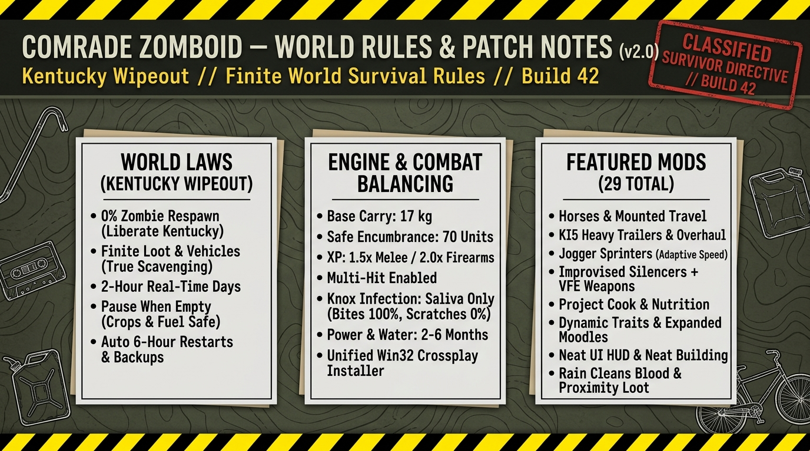

# README.md for Comrade Zomboid GitHub Repository

<div align="center">



# 🧟‍♂️ COMRADE ZOMBOID (Build 42.21 Hardcore)
### *A Finite World Survival Experiment // Zero Zombie Respawn // Native Unified Crossplay*

[](https://github.com/ricorai/Comrade-Zomboid/releases)
[](https://projectzomboid.com)
[-4A90E2?style=for-the-badge)](src/ComradeInstaller.cs)
[](README.md#-featured-mods-roster-29-total)

<p align="center">
  <b>"Every can of food counts, every bullet matters, and every zombie you kill stays dead."</b>
</p>

</div>

---

## 📜 Table of Contents
1. [Overview & Philosophy](#-overview--philosophy)
2. [Quick Start (Players)](#-quick-start-players)
3. [World Rules: Kentucky Wipeout](#-world-rules-kentucky-wipeout)
4. [Engine & Combat Balancing](#-engine--combat-balancing)
5. [Featured Mods Roster (29 Total)](#-featured-mods-roster-29-total)
6. [Technical Architecture (The Iceberg Principle)](#-technical-architecture-the-iceberg-principle)
7. [Version History & Evolution](#-version-history--evolution)
8. [Building from Source](#-building-from-source)

---

## 🧭 Overview & Philosophy

**Comrade Zomboid** is a curated hardcore survival server running on **Project Zomboid Build 42.21**. 

Standard multiplayer servers often fail for two reasons:
1. **Endless Grind / Respawn Fatigue:** Constant zombie respawns make clearing towns feel meaningless.
2. **Onboarding Friction:** Version mismatches, archive confusion, and the Steam vs. Cracked (Hydra / OnlineFix) authentication split divide friend groups.

Comrade Zomboid solves both:
* **In-Game:** Kentucky is a **finite world**. What you loot is gone; what you kill is permanently dead. You and your squad can systematically liberate towns street by street.
* **Under the Hood:** A native **31.5 KB Win32 installer** (`ComradeInstaller.exe`) built with the zero-dependency **QuickVolume architecture** automatically detects the player's game edition, bridges the Steam AppID 480 Spacewar crossplay gap, and stages all 29 mods in under 2 seconds.

---

## 🚀 Quick Start (Players)

### Option 1: 1-Click Installer (Recommended)
1. Download the latest **`Comrade_Zomboid_Unified_Installer.rar`** from [Google Drive Download Hub](https://drive.google.com/drive/folders/1jf5MrRtTg-AyWSdbLXJ1suU6J3UHaeQs).
2. Extract the folder to your PC.
3. Double-click **`1_Launch_Installer.bat`** (or `ComradeInstaller.exe`).
4. Click **"Install Comrade Modpack"**:
   * **If Cracked (Hydra / OnlineFix):** Instantly copies the 40 mod directories directly into `%USERPROFILE%\Zomboid\mods\`.
   * **If Paid Steam:** Stages all mods and creates a desktop **`Comrade Zomboid (Crossplay).bat`** launcher.
5. In Project Zomboid Main Menu -> **JOIN**:
   * **Server Name:** `Comrade Zomboid`
   * **Host:** `chords-auxiliary.tun.ply.gg`
   * **Port:** `16909`
   * **Server Password:** `comrade`
   * **Account Username / Password:** Type your preferred survivor credentials (saved automatically on first join).

> [!IMPORTANT]
> **Horse Mod Note (Vanilla B42 Quirk):** When launching for the first time, go to **Main Menu -> MODS**, ensure **Horse Mod** has a green checkmark, click **Accept**, and restart your game once. This preloads the 3D animal skeletal hierarchy into memory. All other 28 mods are loaded automatically by the server!

---

## 🗺️ World Rules: Kentucky Wipeout

| Rule | Configuration | Survivor Impact |
| :--- | :--- | :--- |
| **Zombie Respawn** | **0.0 (Disabled)** | Every zombie killed permanently reduces the horde. Towns can be liberated. |
| **Loot Respawn** | **None (Finite)** | Scavenging is authentic. Renewable survival (farming, trapping, foraging, fishing) becomes critical. |
| **Day Length** | **2 Hours Real-Time** | Strategic pacing: daylight allows extensive excursions; nighttime is genuinely dangerous. |
| **World Persistence** | **Pause When Empty** | Crops won't rot and generators won't drain fuel when no players are online. |
| **Server Maintenance** | **6-Hour Automated Restarts** | Automated world backups and RAM defragmentation (00:00, 06:00, 12:00, 18:00). |

---

## ⚖️ Engine & Combat Balancing

* **Carry Weight & Encumbrance:** Base carry capacity tuned to **17 kg** with safe encumbrance protection up to **70 units** (preventing the unplayable sudden fracture bug caused by DynamicTraits stacking).
* **Knox Infection:** **Saliva Only** (Bites = 100% lethal; scratches and lacerations carry standard wound infection risks but 0% Knox virus).
* **Combat Multi-Hit:** **Enabled** for melee weapons (authentic crowd control against wandering groups).
* **XP Multipliers:** **1.5x Melee / 2.0x Firearms** (respects players' real-world time while preserving survival progression).
* **Infrastructure Shutoff:** Electricity and municipal water shut off between **2 to 6 months in-game**, giving survivors time to establish rain collection and generator networks.

---

## 🎒 Featured Mods Roster (29 Total)

<div align="center">

| Category | Mods Included | Gameplay Enhancement |
| :--- | :--- | :--- |
| **Equine & Mounted** | `HorseMod` | Rideable horses, saddle storage, stamina pacing, and animal husbandry. |
| **Vehicles & Trailers** | `KI5trailers`, `damnlib`, `damnlibGlass`, `Vehicle Repair Overhaul` | Heavy-duty hitch trailers, vehicle armor salvaging, and realistic towing physics. |
| **Zombie AI & Threat** | `joggerSprinters` | Blends shamblers with unpredictable jogger zombies to eliminate walking complacency. |
| **Weapons & Ballistics** | `VFE` (Vanilla Firearms Expanded), `Improvised Silencers` | Balanced period-accurate 1993 firearms, custom attachments, and craftable suppressors. |
| **Culinary & Scavenging** | `Project_Cook`, `Project_Cook_Pixel_Icon` | Deep cooking recipes, food preservation, and calorie balancing. |
| **Survival & Immersion** | `Common Sense`, `DynamicTraits`, `MoodleFramework`, `RainCleansBlood` | Crowbar door prying, dynamic trait progression, rain washing blood from surfaces. |
| **User Interface (HUD)** | `NeatUI_Framework`, `NeatUI_CharacterInfo`, `BetterSorting`, `ItemArrange`, `ManageContainers` | Modernized status bars, inventory category sorting, container auto-categorization. |
| **Expanded Architecture** | `Neat_Building`, `Neat_Building_Railings`, `Neat_Crafting` | Extended carpentry, custom fences, barricade aesthetics, and expanded crafting. |

</div>

---

## 🏛️ Technical Architecture (The Iceberg Principle)

Following the engineering philosophy of [QuickVolume](https://github.com/ricorai/QuickVolume): **Simple surface, deep structure.**

```text
               [ USER INTERFACE (31.5 KB) ]
             ComradeInstaller.exe (WinForms GDI+)
        ----------------------------------------------  <- Surface
             [ REGISTRY & HEURISTIC DETECTION ]
           Steam Path  •  Library VDF  •  Emulator Check
        ----------------------------------------------
             [ DUAL INSTALLATION ENGINE ]
        Local 'mods/' Direct Copy  •  mods.zip In-Memory Extraction
        ----------------------------------------------
             [ CROSSPLAY INJECTION LAYER ]
           SteamAppId=480  •  SteamGameId=480  •  Playit Tunnel
        ----------------------------------------------
             [ IN-GAME BALANCE PATCHER ]
         DynamicTraits LUA Carry & Encumbrance Override
```

### Key Technical Specs:
* **Zero Dependencies:** Pure C# targeting the native Windows .NET Framework 4.0 runtime (`C:\Windows\Microsoft.NET\Framework64\v4.0.30319\csc.exe`). No Electron, Chromium, Python, or runtime installs required.
* **Instant Startup:** Sub-100ms cold boot; runs at 0% idle CPU with pure GDI+ double-buffered dark Fluent theme (`#1F1F1F` surface, `#A6A5A1` Warm Silver accents).
* **Automated AppID 480 Bridging:** Resolves the Steam authentication barrier by generating a tailored launcher (`Comrade Zomboid (Crossplay).bat`) injecting `SteamAppId=480` (Spacewar) so Paid Steam clients sync with Hydra / OnlineFix players.
* **Socket Diagnostics:** Native DNS lookup for `chords-auxiliary.tun.ply.gg` and TCP/UDP socket connectivity verification directly inside the binary.

---

## 📈 Version History & Evolution

<details open>
<summary><b>Click to expand full development timeline</b></summary>
<br>

### `v2.0` — The QuickVolume Architecture (Current)
* **Unified Native Installer:** Completely replaced fragile multi-script installers with a standalone 31.5 KB C# Win32 binary (`ComradeInstaller.exe`).
* **Automated Edition Detection:** Intelligent registry and signature scans determine whether the user is on Paid Steam or Cracked/Hydra.
* **AppID 480 Crossplay Automation:** Automatically generates the desktop launcher with Spacewar environment hooks.
* **Integrated Trait Patcher:** Automatically balances `DynamicTraits` carry capacity (17 kg base, 70 max safe load) during installation.
* **Built-in Diagnostics:** Integrated live socket and DNS ping tools for instant network verification.
* **Admin Security Lockdown:** Server access control hardened with dedicated root administrator credentials (`admincomrade`) and live RCON options reloading.

### `v1.2` — Expansion & The Tunnel Overhaul
* **Modpack Expansion:** Upgraded from 18 to 29 active mods (added Horses, KI5 Trailers, Jogger Sprinters, Project Cook, and Neat UI).
* **Headless Infrastructure:** Server detached into an independent Win32 console process (`PID 6888`) under Windows Scheduled Tasks.
* **Zero-Port-Forwarding Tunnel:** Integrated self-healing Playit.gg network tunnel bridging WAN and LAN traffic.

### `v1.1` — Kentucky Wipeout & The Balance Patch
* **Hardcore World Laws:** Established 0% zombie respawn and finite loot distribution rules.
* **Encumbrance Fix:** Diagnosed and corrected the fatal character fracture bug where stacked traits caused sudden unprovoked bone breaks.
* **Crossplay Proof of Concept:** Manually proved Steam client connectivity to OnlineFix server instances via AppID 480 environment overrides.

### `v1.0` — Inception & Dedicated Server Setup
* Initial dedicated server deployment on Project Zomboid Build 42.
* Basic multi-part batch scripts and manual RAR mod distribution.
* Initial testing of LAN vs WAN networking.

</details>

---

## 🛠️ Building from Source

You do not need Visual Studio, NuGet, or any external package managers. Compile natively on any Windows 10/11 machine using the built-in compiler:

```cmd
cd src
build.bat
```

Inside `build.bat`:
```cmd
C:\Windows\Microsoft.NET\Framework64\v4.0.30319\csc.exe /target:winexe /optimize+ /platform:anycpu /out:..\ComradeInstaller.exe /r:System.dll,System.Drawing.dll,System.Windows.Forms.dll,System.Data.dll,System.IO.Compression.FileSystem.dll ComradeInstaller.cs
```
*Build completes in ~1.2 seconds.*

---

## 🤝 Contributing & Community

Created with ❤️ for the Comrade Zomboid community. Issues, feature requests, and mod balance discussions are welcome via GitHub Issues.

<div align="center">
  <sub>Built under the Ryos Core 9.7 Framework • Iceberg Principle Architecture</sub>
</div>
